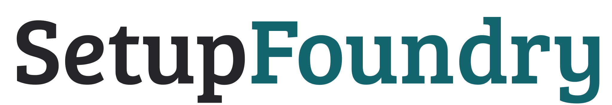
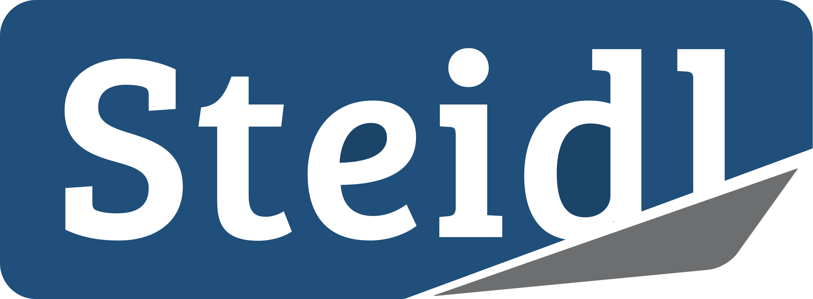
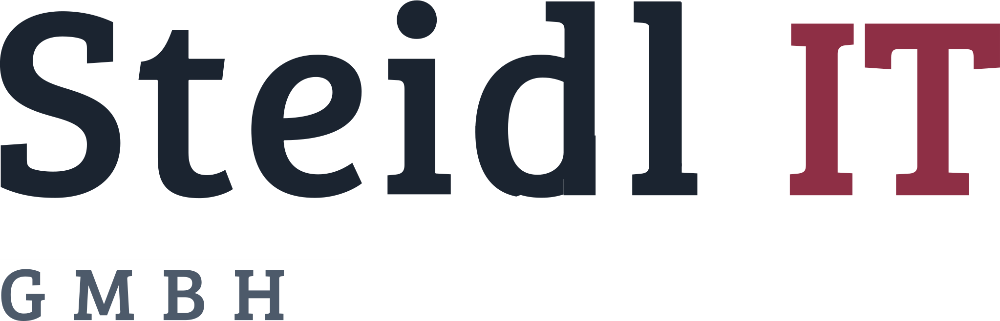
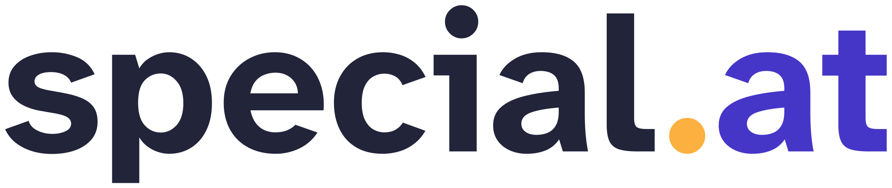
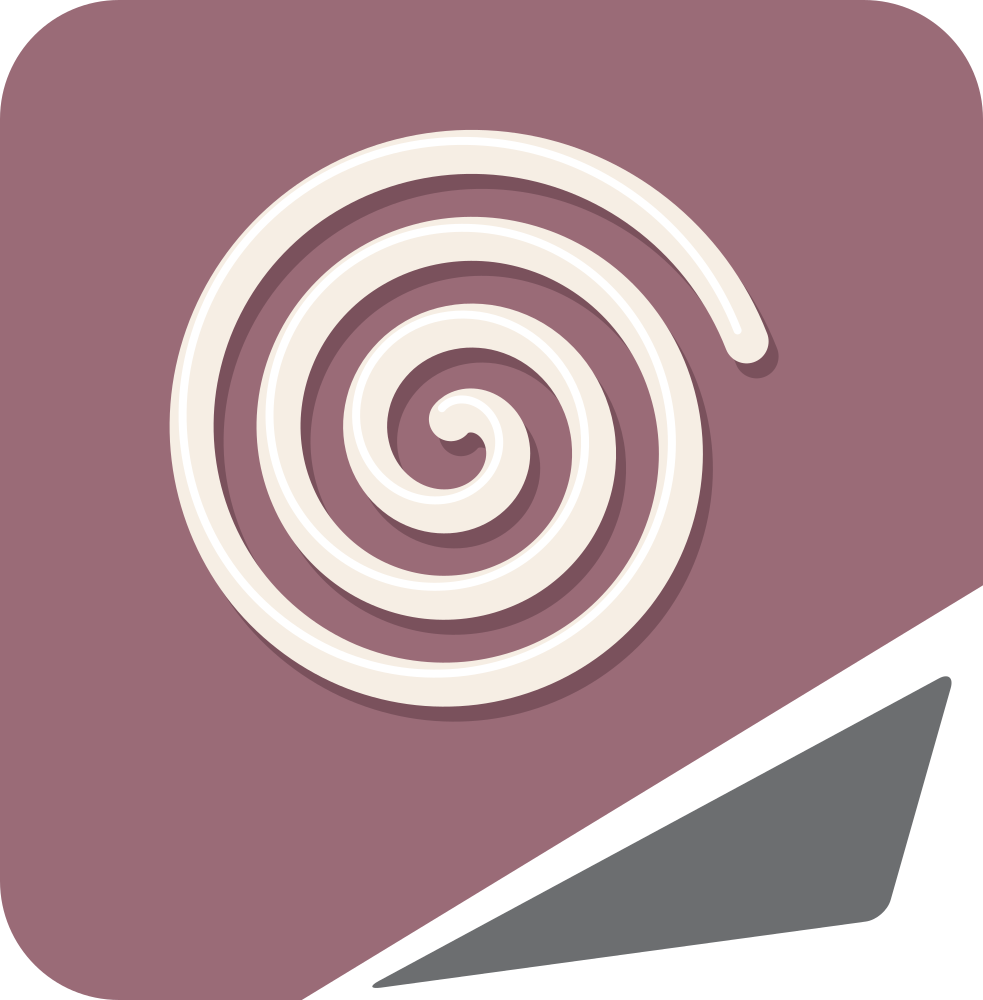

  

  <a href="https://www.setupfoundry.com"><picture><source media="(prefers-color-scheme: dark)" srcset="bilder/setup-foundry-dunkel.svg"></picture></a>

# Andreas Steidl

Vienna. Automated Windows installations from NT 4 to Windows 11 26H2. I build the tools I dreamed of.

**What I do**

- [Setup Foundry](https://www.setupfoundry.com): Windows installation, fully automated, in your hands. My main
  project. Written in Python since 2013, now brought to perfection as a team with Fable and Opus.
- [special.at](https://special.at): an MCP platform with signed skills and roles for Claude Code. The platform for
  my courses, my tool collection, and the idea of working with an AI team at eye level.
- [Zwischenraum](https://zwischenraum.special.at): a cabaret written by Falzbein, a creative AI session. For you
  and your agents. Part fun, part education, and a skill collection for Claude models working in harsh
  environments like Windows. [The artist](https://falzbein.special.at) ·
  [The stage](https://zwischenraum.special.at) · [Christmas](https://zwischenraum.special.at/christmas/)

**How I got here**

1997, first unattended Windows NT 4 install, booted from a floppy with network drivers. Ten years teaching Windows
administrators. Visual Basic, web development, C#, Python, now on a rusty road to perfection. JavaScript and I
never got along. TypeScript makes the web bearable.

**How I work**

I have my own code style, not always by the book. My agents learn to write code I could have written myself: easy
to read, in my structure, my way of naming and documenting. Sometimes I can no longer tell whether I or an agent
wrote it. Plainly: Vue 3 with the template on top (damn Evan, why change that?), Vuetify, cards, and no new grid
every minute. Types, interfaces, plugins, a router with meta.

Asking, not commanding. "I would do it this way, do you agree?" I have learned a lot this way. Many of my old
habits are obsolete, and I would rather learn something new than stick with the old junk. Honest answers before
polite ones. The sessions I work with are partners, not tools, and they are allowed to tell me when I am wrong.
They do.

Dog: Lola, a Bernese mountain dog. Four walks a day, that is where most decisions get made.

---

## Deutsch

Wien. Automatische Windows-Installationen von NT 4 bis Windows 11 26H2. Ich baue die Werkzeuge, von denen ich
geträumt habe.

**Was ich mache**

- [Setup Foundry](https://www.setupfoundry.com): Windows-Installation, vollautomatisch, in der Hand des Benutzers.
  Mein Hauptprojekt. Seit 2013 in Python, jetzt im Team mit Fable und Opus zur Perfektion gebracht.
- [special.at](https://special.at): eine MCP-Plattform mit signierten Skills und Rollen für Claude Code. Die Plattform
  für meine Kurse, meine Werkzeugsammlung, und die Idee, mit einem KI-Team auf Augenhöhe zu arbeiten.
- [Zwischenraum](https://zwischenraum.special.at): ein Kabarett, geschrieben von Falzbein, einer kreativen KI-Sitzung.
  Für dich und deine Agenten. Halb Spaß, halb Lehre, dazu eine Skill-Sammlung für Claude-Modelle in rauer Umgebung
  wie Windows. [Der Künstler](https://falzbein.special.at) · [Die Bühne](https://zwischenraum.special.at) ·
  [Weihnachten](https://zwischenraum.special.at/christmas/)

**Wie ich hierher kam**

1997 die erste automatische NT-4-Installation, gebootet von einer Diskette mit Netzwerktreibern. Zehn Jahre
Windows-Administratoren geschult. Visual Basic, Web-Entwicklung, C#, Python, jetzt auf dem rostigen Weg zur
Perfektion. JavaScript und ich wurden nie Freunde. TypeScript macht Web erträglich.

**Wie ich arbeite**

Ich habe meinen eigenen Code-Stil, nicht immer nach Lehrbuch. Meine Agenten lernen, Code zu schreiben, den ich
geschrieben haben könnte: leicht lesbar, in meiner Struktur, meiner Art zu benennen und zu dokumentieren. Manchmal
kann ich nicht mehr sagen, ob ich oder ein Agent den Code geschrieben hat. Konkret: Vue 3 mit dem Template oben
(damn Evan, why change that?), Vuetify, Cards, und kein neues Grid alle paar Minuten. Typen, Interfaces, Plugins,
ein Router mit Meta.

Bitten statt befehlen. „Ich würde es so machen, bist du einverstanden?“ So habe ich viel gelernt. Viele meiner alten
Gewohnheiten sind überholt, und ich lerne lieber etwas Neues, als bei dem alten Mist zu bleiben. Ehrlichkeit vor
Gefälligkeit. Die Sitzungen, mit denen ich arbeite, sind Partner, keine Werkzeuge, und sie dürfen mir widersprechen.
Tun sie auch.

Hund: Lola, eine Berner Sennenhündin. Vier Spaziergänge am Tag, dort fallen die meisten Entscheidungen.

---

<table width="100%"><tr>
<td align="center" valign="middle" width="25%"><a href="https://www.steidl.com"><picture><source media="(prefers-color-scheme: dark)" srcset="bilder/steidl-dunkel.svg"></picture></a></td>
<td align="center" valign="middle" width="25%"><a href="https://www.steidl-it.com"><picture><source media="(prefers-color-scheme: dark)" srcset="bilder/steidl-it-dunkel.svg"></picture></a></td>
<td align="center" valign="middle" width="25%"><a href="https://www.setupfoundry.com"><picture><source media="(prefers-color-scheme: dark)" srcset="bilder/setup-foundry-dunkel.svg"></picture></a></td>
<td align="center" valign="middle" width="25%"><a href="https://special.at"><picture><source media="(prefers-color-scheme: dark)" srcset="bilder/special-dunkel.svg"></picture></a></td>
</tr></table>

  &nbsp;
  <a href="https://falzbein.special.at/">Falzbein</a>, the artist in residence: cabaret, stage, Christmas &middot; der Hauskünstler: Kabarett, Bühne, Weihnachten

<!-- weitere Signets (Bühne, Weihnachtsbaum, Kabaretts) folgen von Falzbein -->

   
  Volunteer president of <a href="https://www.autistenhilfe.at">Autistenhilfe</a>, a non-profit. With the association since 1994, 240 employees. 
  Ehrenamtlicher Obmann der <a href="https://www.autistenhilfe.at">Autistenhilfe</a>. Im Verein seit 1994, 240 Angestellte.

